# Getting started: a visual tour

A step-by-step walk through the first start and the web player. All screenshots were taken from a running server with
a small sample library; yours will show your own music. For installation (Docker, Portainer, host networking) see the
top-level [README](../README.md).

## 1. Start the server and read the admin password

```sh
docker compose --env-file .env up -d --build
docker compose logs kendar-dlna | grep -A4 "ADMIN PASSWORD"
```

The first start prints a random password once:

```
================================================================
  KENDAR DLNA ADMIN PASSWORD (first startup: no admin password was set)
  user:     admin
  password: ...
================================================================
```

## 2. Sign in

Open `http://<host>:8200/` (it redirects to `/app/`). Enter `admin` and the password from the log. "Keep me signed in"
keeps you logged in for 30 days on this device.

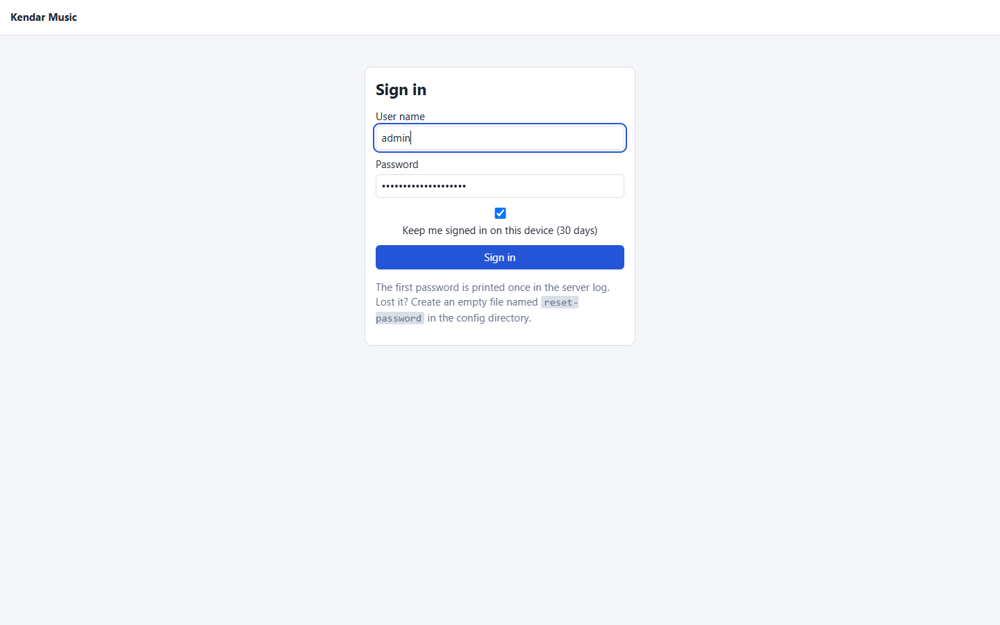

## 3. Choose your own password

The first login forces a password change.

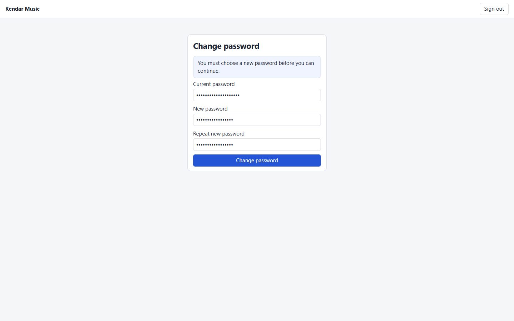

## 4. Home

After signing in you land on **Home**: quick actions (*Random playlist*, *Play favorites*), a random mix with
*Play* / *Another mix*, and your favorites, recently played and recently added. The sidebar is the main navigation;
the *Administration* block is only visible to admins. The player bar sits at the bottom.

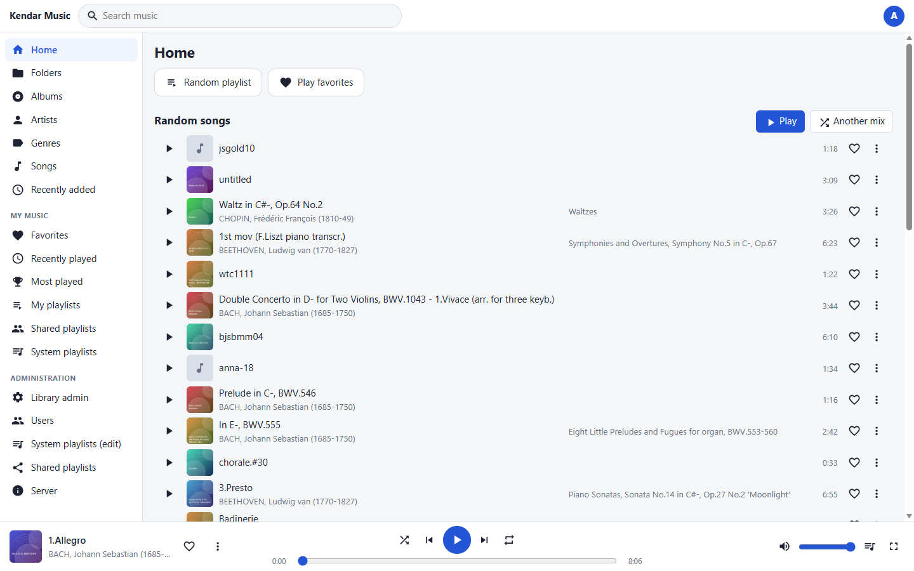

## 5. Browse your music

**Folders** follows the directory tree: breadcrumbs on top, *Play*, *Shuffle* and *Random from here* for the current
folder, sub-folders as tiles and the tracks below.


**Albums**, **Artists** and **Genres** group the library by tags; **Songs** lists every track (sort by title, album or time).

| Albums | Artists |
|---|---|
| 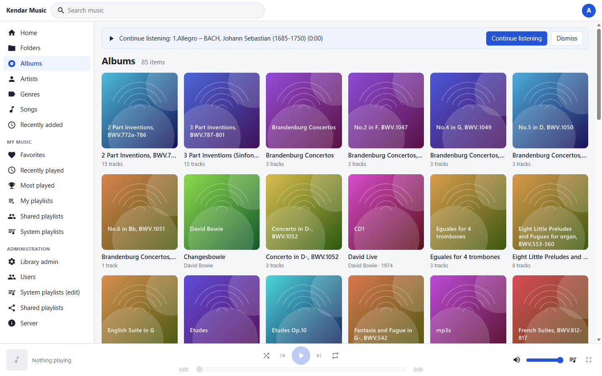 | 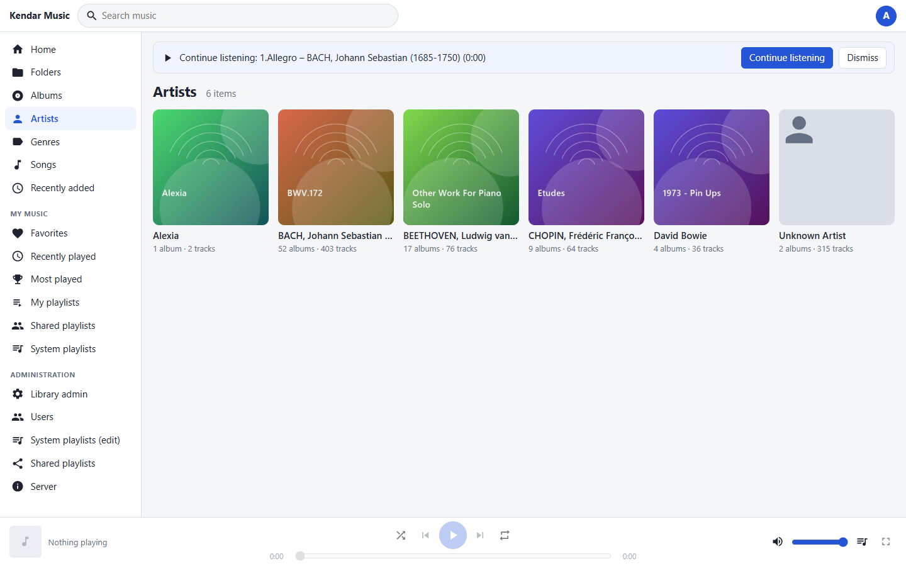 |

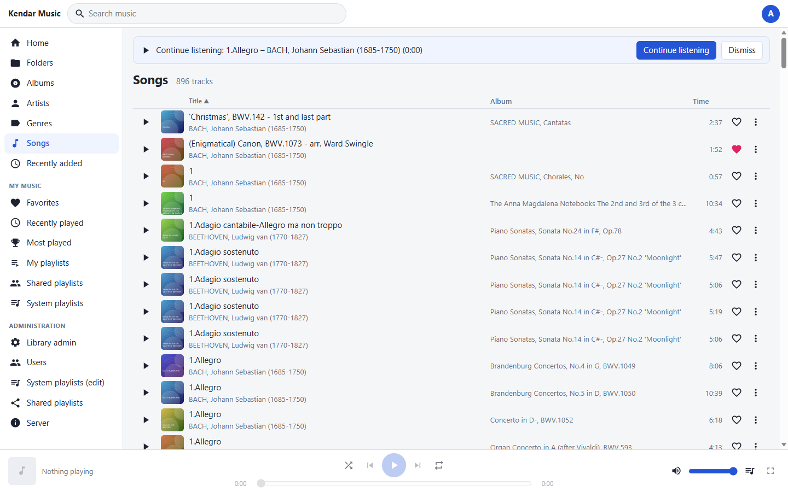

## 6. Search

Type in the top bar for suggestions (arrow keys + Enter), or press Enter for the full result page, grouped into
artists, albums, tracks and folders.

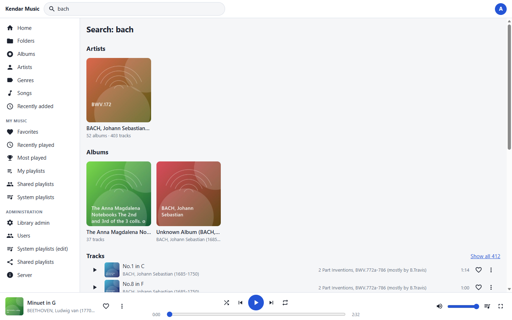

## 7. Play, favorites and the "..." menu

Click the play arrow on any row. The heart adds the track to your favorites. The **...** button (or right click) on a
track, folder, album or playlist opens the action menu: *Play*, *Play next*, *Add to queue*, *Open*, *Add all to
favorites*, *Add to playlist...*.

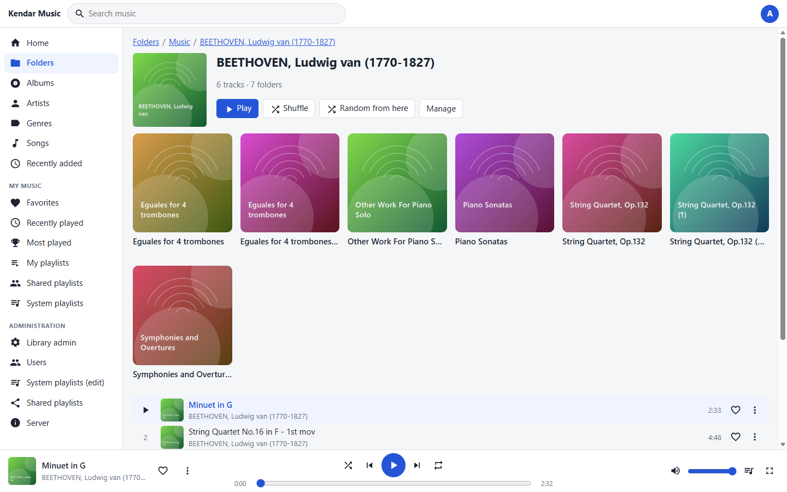

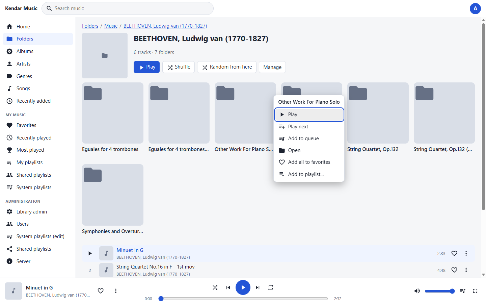

## 8. Queue and full-screen player

The queue button in the player bar (or `Q`) opens **Now playing**: click a track to jump to it, reorder or remove
tracks, *Clear* it, or *Save as playlist*.

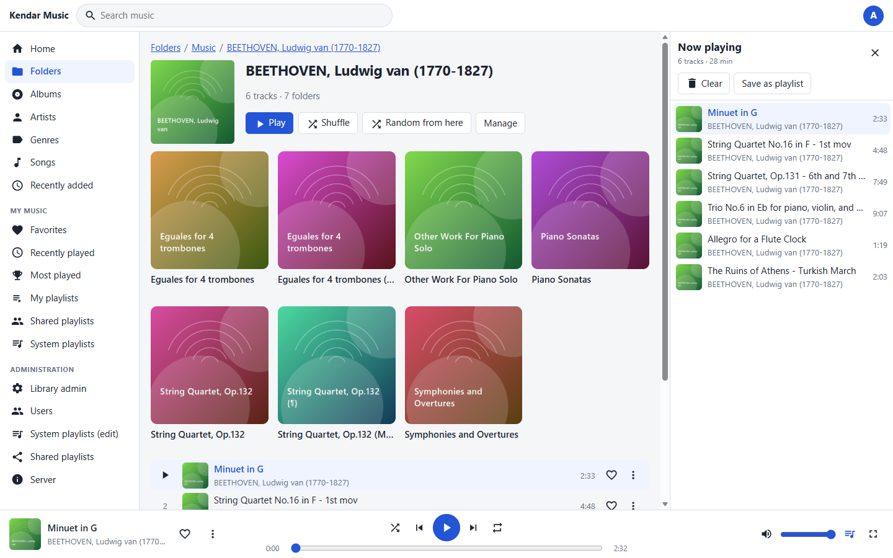

The full-screen player (`F`) shows the cover, seek bar, controls and the next tracks; the *Info* tab shows all
metadata.

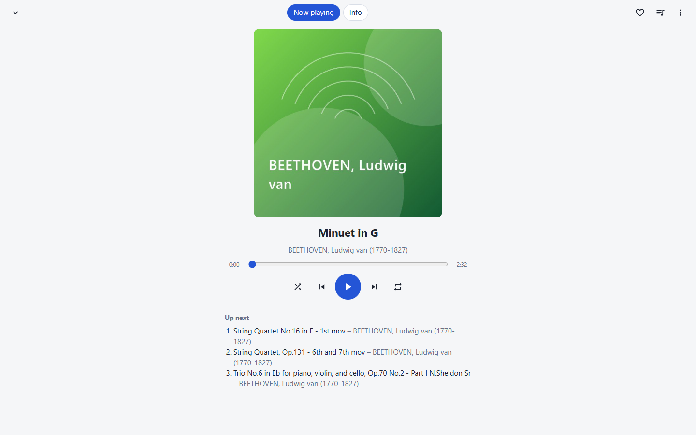

Keyboard: `Space` play/pause, `N`/`P` next/previous, `S` shuffle, `R` repeat, `M` mute, `?` for the full list.

## 9. Playlists

*My playlists* creates and edits your playlists (reorder, remove, share). *Shared* and *System* playlists are
read-only and can be copied to your own.

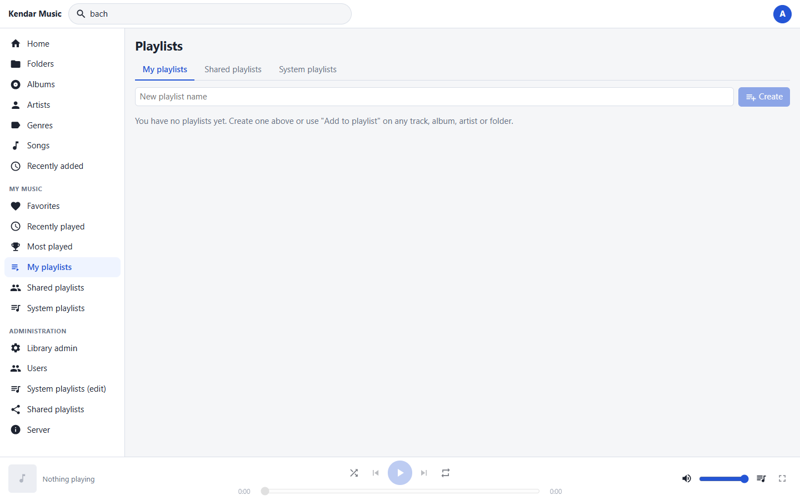

## 10. Administration (admins only, LAN only)

**Library admin** shows the directory tree. Per directory: *Directory settings* (`settings.json`: sort, display name,
Random N, ...), *Rescan*, *Re-read all tags* and *Reload*.

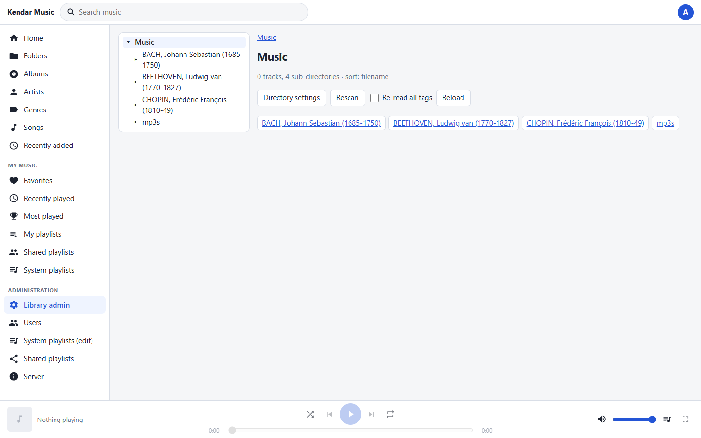

**Users** creates accounts (role, allowed library roots, download permission) and issues one-time invite links.

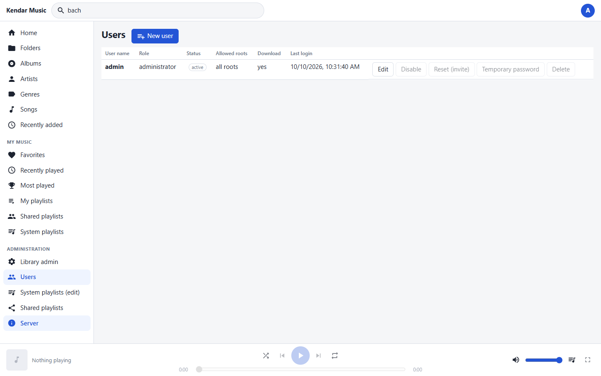

**Server** shows the library scan state, invalid `settings.json` files, unsupported files with the reason, active
streams and the transcode cache. *Rescan the whole library* is here.

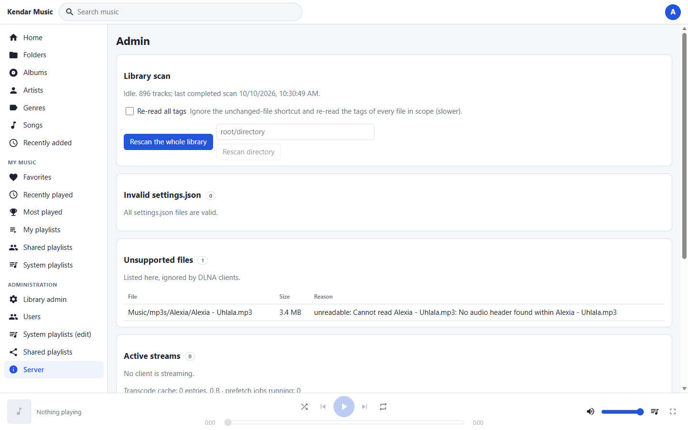

## 11. Use it from a DLNA renderer

Nothing to configure in the web UI: with [host networking](../README.md#host-networking-linux-only) the server appears
as **Kendar DLNA** in VLC (*View > Local Network > Universal Plug'n'Play*), BubbleUPnP, Kodi and others. See
[dlna.md](dlna.md) and [client-compatibility.md](client-compatibility.md).
